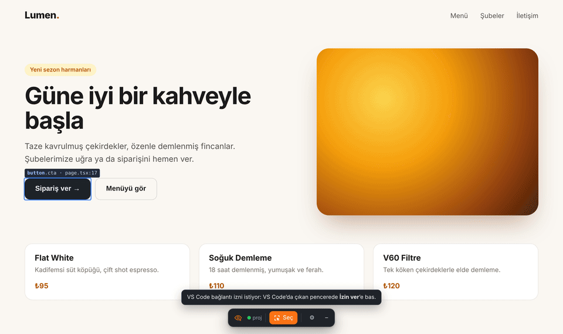

<p align="center">
  
</p>

<h1 align="center">Panoptent</h1>

<p align="center">
  <b>Click any element in your running app, say what to change — Claude Code edits the source.</b><br>
  Emergent-style visual editing for <b>VS Code</b> and <b>Chrome</b>, powered by your existing Claude Code subscription.
</p>

<p align="center">
  <a href="https://ceritli.github.io/panoptent/">Documentation</a> ·
  <a href="https://github.com/ceritli/panoptent/releases/latest">Download</a> ·
  <a href="CONTRIBUTING.md">Contributing</a> ·
  <a href="#türkçe">Türkçe</a>
</p>

<p align="center">
  
</p>

> **Panoptent** = *Panopt*es (the all-seeing giant of Greek myth) + ag*ent*.

## What it does

- **Point instead of describe.** Turn on *Select*, click an element in your app. Panoptent knows the exact file and line it came from (`src/app/page.tsx:17`) and opens it in the editor.
- **Edit right where you clicked.** A small box opens next to the element: write a request, tweak styles live (colors, font, spacing, radius, border, opacity, Tailwind classes), double-click to edit text, delete an element or swap an image.
- **Queue, then apply once.** Changes preview instantly in the page but aren't written yet. Undo/redo freely, then **Apply** sends everything to Claude Code in one request. Plain text edits are written directly — no AI, no tokens.
- **Undo only what Panoptent did.** *Undo last apply* reverses exactly the changes made by that request — your own edits and later conversations are left alone. No git commits are created.
- **Works where you work.** Inside VS Code (built-in preview) or in your own Chrome via the companion extension — including pages behind a login, with DevTools and real device emulation.
- **Responsive-aware.** In mobile or tablet view, mark a change as *mobile only* and it's applied with a breakpoint.

Works with React / Next.js, Vue / Nuxt, Vite, and plain HTML.

## Requirements

- VS Code 1.85+
- [Claude Code for VS Code](https://marketplace.visualstudio.com/items?itemName=anthropic.claude-code) (uses your Claude subscription; no API key)
- Your app's dev server running (`npm run dev`, …)
- Optional: Chrome 116+ for the browser extension

## Install

Download the latest files from **[Releases](https://github.com/ceritli/panoptent/releases/latest)**.

**VS Code** — Extensions panel → `⋯` → **Install from VSIX…** → `panoptent-x.y.z.vsix` → reload the window.

**Chrome** (optional) — unzip `panoptent-chrome-x.y.z.zip` → `chrome://extensions` → enable **Developer mode** → **Load unpacked** → pick the folder.

## Quick start

1. Open your project in VS Code and start the dev server.
2. Click the **eye** icon in the activity bar → **Open Preview** (or Command Palette → *Panoptent: Önizlemeyi Aç*).
3. Press **Seç** (Select), click an element, type what you want, press `Ctrl/⌘+Enter` to queue.
4. Press **Uygula** (Apply). The request lands in your open Claude Code conversation — press Enter there.

In Chrome: open your dev site → extension icon → **Bu sekmede Panoptent'i aç** (`Alt+Shift+P`) → approve the one-time pairing prompt in VS Code.

**Recommended:** run *Panoptent: code-inspector'ı Otomatik Kur* once. It adds [code-inspector-plugin](https://github.com/zh-lx/code-inspector) (dev-only) so every element maps to its exact file and line, and Claude doesn't spend time or tokens searching.

> The interface is currently in Turkish. English UI is on the roadmap.

Full guide, screenshots, settings and troubleshooting: **https://ceritli.github.io/panoptent/**

## How it works

```
 Chrome / VS Code preview          VS Code (Panoptent)                    Claude Code
 ┌──────────────────────┐  select  ┌──────────────────────────────┐  @file  ┌──────────────┐
 │ overlay: highlight,  │ ───────▶ │ queue · prompt builder       │ ──────▶ │ edits source │
 │ popover, style panel │ ◀─────── │ direct text writes · revert  │ ◀────── │  (hot reload)│
 └──────────────────────┘  status  └──────────────────────────────┘  files  └──────────────┘
```

- **VS Code preview:** a local proxy in front of your dev server injects the selection overlay; HMR websockets pass through.
- **Chrome:** a local bridge on `127.0.0.1:47811` (only browser extensions may connect, first connection needs your approval).
- **Undo:** each apply carries an id (`PT-…`); Panoptent reads Claude Code's own session log to find the edits made for that id and reverses them hunk by hunk.

## Development

```bash
npm install
npm run typecheck
npm run package          # → panoptent-x.y.z.vsix
npm run package:chrome   # → panoptent-chrome-x.y.z.zip
```

Press `F5` in VS Code with this folder open to run the extension in a development host. Load `chrome/` unpacked after `npm run package:chrome` (it copies the shared overlay into the folder).

Releases are built by GitHub Actions when the version in `package.json` is bumped on `main` (or a `v*` tag is pushed).

## Contributing

**Contributions of every kind are welcome** — bug reports, ideas, docs, translations (an English UI especially), tests and code. Open an [issue](https://github.com/ceritli/panoptent/issues/new/choose) or a pull request; no need to ask first. See [CONTRIBUTING.md](CONTRIBUTING.md).

## License

[MIT](LICENSE) © Fatih Ceritli, Alper LÜLE

---

## Türkçe

**Çalışan uygulamanda bir öğeye tıkla, ne istediğini yaz — Claude Code kaynak kodu düzenlesin.** VS Code ve Chrome için Emergent tarzı görsel düzenleme; mevcut Claude Code aboneliğinle çalışır.

**Öne çıkanlar**

- **Anlatmak yerine göster.** *Seç*'i aç, öğeye tıkla. Panoptent öğenin hangi dosyanın hangi satırında olduğunu bilir ve editörde açar.
- **Tıkladığın yerde düzenle.** Öğenin yanında açılan kutudan istek yaz, stili canlı değiştir (renk, yazı, boşluk, köşe, kenarlık, opaklık, Tailwind sınıfı), çift tıklayıp metni düzenle, öğeyi sil ya da görseli değiştir.
- **Kuyruğa al, tek seferde uygula.** Değişiklikler sayfada anında görünür ama koda yazılmaz. Geri al/yinele, sonra **Uygula** ile hepsi tek istekte Claude Code'a gider. Metin değişiklikleri AI kullanılmadan doğrudan dosyaya yazılır.
- **Yalnızca kendi yaptığını geri alır.** *Son uygulamayı geri al*, o istekte yapılan değişiklikleri satır satır tersine çevirir; senin düzenlemelerine ve sonraki konuşmalara dokunmaz. Commit oluşturmaz.
- **VS Code içinde ya da kendi Chrome'unda.** Giriş gerektiren sayfalarda, DevTools ve gerçek cihaz emülasyonuyla.
- **Mobil/tablet.** Dar görünümdeyken bir değişikliği *sadece mobil için* işaretleyebilirsin.

**Kurulum**

1. [Releases](https://github.com/ceritli/panoptent/releases/latest) sayfasından dosyaları indir.
2. VS Code: Extensions → `⋯` → **Install from VSIX…** → `.vsix` dosyası → pencereyi yenile.
3. Chrome (isteğe bağlı): zip'i aç → `chrome://extensions` → **Geliştirici modu** → **Paketlenmemiş öğe yükle**.
4. Önerilir: Komut Paleti → **Panoptent: code-inspector'ı Otomatik Kur**.

Ayrıntılı Türkçe rehber, ekran görüntüleri ve sorun giderme: **https://ceritli.github.io/panoptent/**

**Katkı:** Her türlü katkıya açığız — hata bildirimi, fikir, belge, çeviri, test ve kod. [Issue](https://github.com/ceritli/panoptent/issues/new/choose) ya da pull request açman yeterli; ayrıntılar [CONTRIBUTING.md](CONTRIBUTING.md)'de.

**Lisans:** [MIT](LICENSE) © Fatih Ceritli, Alper LÜLE
