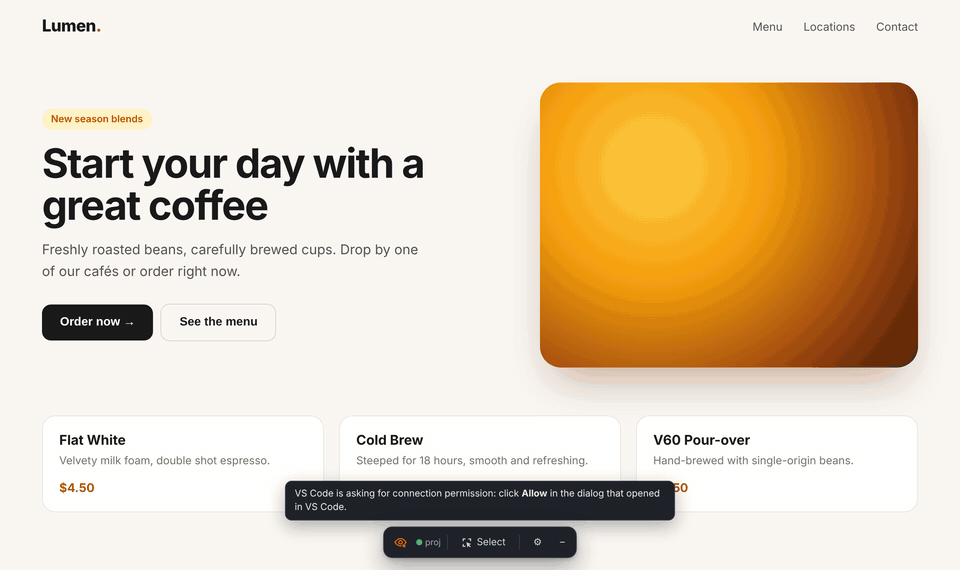

<p align="center">
  
</p>

<h1 align="center">Panoptent</h1>

<p align="center">
  <b>Click any element in your running app, say what to change — Claude Code edits the source.</b><br>
  Emergent-style visual editing for <b>VS Code</b> and <b>Chrome</b>, powered by your existing Claude Code subscription.
</p>

<p align="center">
  <a href="https://ceritli.github.io/panoptent/">Documentation</a> ·
  <a href="https://marketplace.visualstudio.com/items?itemName=ceritli.panoptent">Marketplace</a> ·
  <a href="https://chromewebstore.google.com/detail/panoptent/kmikbnmoacgjjigohbcbmppccjidmacc">Chrome Web Store</a> ·
  <a href="https://open-vsx.org/extension/ceritli/panoptent">Open VSX</a> ·
  <a href="https://github.com/ceritli/panoptent/releases/latest">Download</a> ·
  <a href="CONTRIBUTING.md">Contributing</a> ·
  <a href="#türkçe">Türkçe</a>
</p>

<p align="center">
  
</p>

> **Panoptent** = *Panopt*es (the all-seeing giant of Greek myth) + ag*ent*.

## What it does

- **Point instead of describe.** Turn on *Select*, click an element in your app. Panoptent knows the exact file and line it came from (`src/app/page.tsx:17`) and opens it in the editor.
- **Edit right where you clicked.** A small box opens next to the element: write a request, tweak styles live (colors, font, spacing, radius, border, opacity, Tailwind classes), double-click to edit text, delete an element or swap an image.
- **Queue, then apply once.** Changes preview instantly in the page but aren't written yet. Undo/redo freely, then **Apply** sends everything to Claude Code in one request. Plain text edits are written directly — no AI, no tokens.
- **Undo only what Panoptent did.** *Undo last apply* reverses exactly the changes made by that request — your own edits and later conversations are left alone. No git commits are created.
- **Works where you work.** Inside VS Code (built-in preview) or in your own Chrome via the companion extension — including pages behind a login, with DevTools and real device emulation.
- **Responsive-aware.** In mobile or tablet view, mark a change as *mobile only* and it's applied with a breakpoint.
- **Follows your design rules.** Keep a `design.md` (or pick any file) and every request reminds Claude to follow it — no need to mention it yourself.
- **English and Turkish UI.** Switch live; prompts to Claude are written in the same language.

Works with React / Next.js, Vue / Nuxt, Vite, and plain HTML.

## Requirements

- VS Code 1.85+
- [Claude Code for VS Code](https://marketplace.visualstudio.com/items?itemName=anthropic.claude-code) (uses your Claude subscription; no API key)
- Your app's dev server running (`npm run dev`, …)
- Optional: Chrome 116+ for the browser extension

## Install

**VS Code** — search **Panoptent** in the Extensions panel, or install from the [Visual Studio Marketplace](https://marketplace.visualstudio.com/items?itemName=ceritli.panoptent). Updates are automatic. **Cursor, Windsurf, VSCodium:** install from [Open VSX](https://open-vsx.org/extension/ceritli/panoptent). (Offline: `.vsix` from [Releases](https://github.com/ceritli/panoptent/releases/latest) → Extensions → `⋯` → **Install from VSIX…**)

**Chrome** (optional) — install from the [Chrome Web Store](https://chromewebstore.google.com/detail/panoptent/kmikbnmoacgjjigohbcbmppccjidmacc) (**Add to Chrome**). Updates are automatic. (Manual: unzip `panoptent-chrome-x.y.z.zip` from [Releases](https://github.com/ceritli/panoptent/releases/latest) → `chrome://extensions` → **Developer mode** → **Load unpacked**.)

## Quick start

1. Open your project in VS Code and start the dev server.
2. Click the **eye** icon in the activity bar → **Open Preview** (or Command Palette → *Panoptent: Open Preview*).
3. Press **Select**, click an element, type what you want, press `Ctrl/⌘+Enter` to queue.
4. Press **Apply**. The request lands in your open Claude Code conversation — press Enter there.

In Chrome: open your dev site → extension icon → **Turn on Panoptent in this tab** (`Alt+Shift+P`) → approve the one-time pairing prompt in VS Code.

### Use it from any AI agent (MCP)

Panoptent also runs a local **MCP server**, so Claude Code in the terminal, Cursor, Windsurf or any other MCP client can read what you selected instead of you describing it. Run *Panoptent: Connect Claude Code (MCP)* once per project (it runs the command below for you), or *Panoptent: Copy MCP Connect Command* and paste it in a terminal in your project:

```bash
claude mcp add --transport http panoptent http://127.0.0.1:47821/mcp
```

Then just say *"make the selected button bigger"*, or type `/mcp__panoptent__apply_queue` in Claude Code to apply your whole queue (undo still works). Tools: `get_selection` (elements with file/line, HTML and styles), `get_queue` (queued changes), `get_page_context` (page URL, viewport, workspace), `get_apply`, `start_live` / `wait_for_apply` (live mode), `mark_applied`, and three that act on the page: `screenshot_element` (an image of the selected element, so Claude can check it before and after an edit), `highlight` (Claude outlines the elements it means) and `preview_style` (Claude shows a proposed style live, without touching the code, so you can compare options first).

**Live mode: `/panoptent live`.** *Panoptent: Connect Claude Code (MCP)* also installs a `/panoptent` command for Claude Code (`~/.claude/commands/panoptent.md`; a file you wrote yourself is never overwritten). Type `/panoptent live` once and Claude waits for you: every time you press **Apply** in the preview or in Chrome, the change set goes straight to that conversation (nothing to paste, no new tab), Claude makes the edits and waits for the next one. To stop, tell Claude to stop (or `/panoptent stop`). Claude Code also lists it as `/panoptent:live (MCP)`; both do the same. Also: `/panoptent apply` (apply the queue), `/panoptent selection make these the same size`, and the matching MCP prompts `/mcp__panoptent__live` and `/mcp__panoptent__selection`. Claude waits with a quiet background command (tool `start_live`), so the conversation stays free; other MCP clients can loop on `wait_for_apply`.

Set **Send to** to **Claude Code (MCP)** to make **Apply** skip the request file: it copies a one-line command (`Apply the Panoptent change set PT-…`) for your Claude Code conversation, and Claude fetches the details over MCP. Panoptent offers to connect Claude Code the first time you pick it. For Cursor and others, add `http://127.0.0.1:47821/mcp` as an HTTP (streamable) MCP server. With several VS Code windows open, each gets the next port (47822, …); the command copies the right one. Turn it off with `panoptent.mcpServer`.

### Test and Decisions

When an agent finishes a piece of work, it should not leave "what to try" and "what to decide" scattered in the chat. With the MCP tool `save_check_topic` it records them as one **topic** in your project: `.panoptent/checks/open/<topic>.json` (plain JSON, meant to be committed, so a colleague can take it over; history is kept in `.panoptent/checks/archive/`).

- A **Test** button with a badge appears in the Panoptent bar (VS Code preview and Chrome): how many steps and decisions are waiting for you. It opens a panel on top of your app with three parts: **Test** (tick a step, or press **Problem** and write a note; **Open ↗** goes to the step's page), **Decide** (pick an option; the first one is always today's behaviour) and **Info**.
- Steps that belong to the page you are on are listed first with an **on this page** tag.
- With two or more topics, a one-line **topic picker** at the top switches between them: ‹ › buttons (or arrow keys), and a click opens the list with search. Counts turn green when a topic is complete and red when a step has a problem.
- Every mark is written to the file **at once** (who, when). If it cannot be saved you see it in the panel, and the mark goes back.
- "Who" is your **GitHub user name**: the setting `panoptent.checks.userName`, else the GitHub CLI (`gh api user`), else `git config github.user`; only as a last resort `git config user.name` or the system user. The view and *Panoptent: Test and Decisions* show which source is used. E-mail addresses are never written.
- The panel runs inside the page you are developing, so scripts on that page can read the topic text: never put passwords, tokens or customer data in test steps or notes.
- With a problem marked, **Also add to queue** puts your note (with the selected elements) into the normal change queue.
- The agent reads your results with `get_check_topics` / `get_check_changes` (only what changed since its last read), fixes problems, applies the options you picked and closes the topic with `close_check_topic` when every step is done and every decision is made. In Claude Code: `/panoptent checks`.
- The in-page panel can be moved (drag its title bar), resized (edges and corners), minimized to its title bar with a counter, and maximized; arrow keys move it and Shift+arrows resize it while the title bar has focus. Its position and size are remembered across reloads.
- **Full page in VS Code:** *Panoptent: Open Test and Decisions as a Page* (or **⧉** in the panel) opens all open topics in an editor tab, with filters for problems, untested steps and undecided decisions.
- In VS Code: the **Test and Decisions** view in the Panoptent sidebar lists open topics (click one to open the full page on that topic); *Panoptent: Test and Decisions* and *Panoptent: Show Test and Decisions on the Page*.

Rules for agents (also in the tool descriptions and in `/panoptent`): each step checks one thing and names the page, record and button; the expected result is concrete; `agent: true` only for steps the agent actually ran, and untried things are never written as tried; every rule the agent chose by itself is a decision whose first option is the current behaviour, and nothing is applied until you pick; lasting decisions go into the project's own docs before the topic is closed. File format, HTTP API and details: [docs/checks.md](docs/checks.md).

**Recommended:** run *Panoptent: Set Up code-inspector Automatically* once. It adds [code-inspector-plugin](https://github.com/zh-lx/code-inspector) (dev-only) so every element maps to its exact file and line, and Claude doesn't spend time or tokens searching.

### Language

The UI is available in **English** and **Turkish**. By default it follows VS Code's display language (English if unsupported). Switch it any time, live, with the `panoptent.language` setting (`auto` / `en` / `tr`), the *Panoptent: Change Language* command, the **Language** link in the Panoptent view, the language select in the preview toolbar, or the **Settings** tab of the in-page drawer in Chrome. Chrome follows VS Code once connected. Prompts sent to Claude Code are written in the UI language, so Claude replies in it too.

Full guide, screenshots, settings and troubleshooting: **https://ceritli.github.io/panoptent/**

## How it works

```
 Chrome / VS Code preview          VS Code (Panoptent)                    Claude Code
 ┌──────────────────────┐  select  ┌──────────────────────────────┐  @file  ┌──────────────┐
 │ overlay: highlight,  │ ───────▶ │ queue · prompt builder       │ ──────▶ │ edits source │
 │ popover, style panel │ ◀─────── │ direct text writes · revert  │ ◀────── │  (hot reload)│
 └──────────────────────┘  status  └──────────────────────────────┘  files  └──────────────┘
```

- **VS Code preview:** a local proxy in front of your dev server injects the selection overlay; HMR websockets pass through.
- **Chrome:** a local bridge on `127.0.0.1:47811` (only browser extensions may connect, first connection needs your approval).
- **Undo:** each apply carries an id (`PT-…`); Panoptent reads Claude Code's own session log to find the edits made for that id and reverses them hunk by hunk.

## Development

```bash
npm install
npm run typecheck
npm test                 # unit and integration tests (node:test, no extra dependencies)
npm run package          # → panoptent-x.y.z.vsix
npm run package:chrome   # → panoptent-chrome-x.y.z.zip
```

`npm run test:e2e -- --playwright <path to an installed playwright package>` runs the extension's real code with a stubbed `vscode` module against a headless Chromium (VS Code preview path; the Chrome bridge stays off and the MCP server uses a random port outside 47821–47830).

Press `F5` in VS Code with this folder open to run the extension in a development host. Load `chrome/` unpacked after `npm run package:chrome` (it copies the shared overlay into the folder).

Releases are built by GitHub Actions when the version in `package.json` is bumped on `main` (or a `v*` tag is pushed).

## Contributing

**Contributions of every kind are welcome** — bug reports, ideas, docs, translations into new languages, tests and code. Open an [issue](https://github.com/ceritli/panoptent/issues/new/choose) or a pull request; no need to ask first. See [CONTRIBUTING.md](CONTRIBUTING.md).

## Privacy

Panoptent collects no data: no servers, no analytics. The Chrome extension only talks to VS Code on your own computer (`127.0.0.1`). The MCP server also listens on `127.0.0.1` only and refuses requests from web pages. [Privacy policy](https://ceritli.github.io/panoptent/privacy.html)

## License

[MIT](LICENSE) © Fatih Ceritli, Alper LÜLE

---

## Türkçe

**Çalışan uygulamanda bir öğeye tıkla, ne istediğini yaz — Claude Code kaynak kodu düzenlesin.** VS Code ve Chrome için Emergent tarzı görsel düzenleme; mevcut Claude Code aboneliğinle çalışır.

**Öne çıkanlar**

- **Anlatmak yerine göster.** *Seç*'i aç, öğeye tıkla. Panoptent öğenin hangi dosyanın hangi satırında olduğunu bilir ve editörde açar.
- **Tıkladığın yerde düzenle.** Öğenin yanında açılan kutudan istek yaz, stili canlı değiştir (renk, yazı, boşluk, köşe, kenarlık, opaklık, Tailwind sınıfı), çift tıklayıp metni düzenle, öğeyi sil ya da görseli değiştir.
- **Kuyruğa al, tek seferde uygula.** Değişiklikler sayfada anında görünür ama koda yazılmaz. Geri al/yinele, sonra **Uygula** ile hepsi tek istekte Claude Code'a gider. Metin değişiklikleri AI kullanılmadan doğrudan dosyaya yazılır.
- **Yalnızca kendi yaptığını geri alır.** *Son uygulamayı geri al*, o istekte yapılan değişiklikleri satır satır tersine çevirir; senin düzenlemelerine ve sonraki konuşmalara dokunmaz. Commit oluşturmaz.
- **VS Code içinde ya da kendi Chrome'unda.** Giriş gerektiren sayfalarda, DevTools ve gerçek cihaz emülasyonuyla.
- **Tasarım kurallarına uyar.** Projede `design.md` varsa (ya da istediğin dosyayı seçersen) her istekte Claude'a ona uymasını Panoptent kendisi hatırlatır; senin ayrıca yazmana gerek kalmaz. Paneldeki **Tasarım kuralları** satırından ya da *Panoptent: Tasarım Kuralları Dosyasını Seç* komutuyla seçilir.
- **Mobil/tablet.** Dar görünümdeyken bir değişikliği *sadece mobil için* işaretleyebilirsin.
- **Türkçe ve İngilizce arayüz.** Varsayılan olarak VS Code'un dilini izler; `panoptent.language` ayarı, *Panoptent: Dili Değiştir* komutu, önizleme araç çubuğundaki dil seçimi ya da Chrome'da **Ayarlar** sekmesiyle anında değiştirilir. Claude'a giden istemler de seçilen dilde yazılır.

**Kurulum**

1. VS Code: Extensions panelinde **Panoptent** ara ve kur ya da [Marketplace](https://marketplace.visualstudio.com/items?itemName=ceritli.panoptent) sayfasından kur. Güncellemeler otomatik gelir. Cursor, Windsurf, VSCodium: [Open VSX](https://open-vsx.org/extension/ceritli/panoptent).
2. Chrome (isteğe bağlı): [Chrome Web Store](https://chromewebstore.google.com/detail/panoptent/kmikbnmoacgjjigohbcbmppccjidmacc) sayfasından **Chrome'a ekle**. Güncellemeler otomatik gelir. (Elle kurulum: [Releases](https://github.com/ceritli/panoptent/releases/latest)'tan zip'i indirip aç → `chrome://extensions` → **Geliştirici modu** → **Paketlenmemiş öğe yükle**.)
3. Önerilir: Komut Paleti → **Panoptent: code-inspector'ı Otomatik Kur**.
4. Sol menüdeki göz → **Önizlemeyi Aç**; **Seç**'e bas, öğeye tıkla, isteğini yaz, **Uygula**. Chrome'da: eklenti simgesi → **Bu sekmede Panoptent’i aç**.

**Her yapay zekâ aracından kullan (MCP).** Panoptent yerel bir **MCP sunucusu** da açar; terminaldeki Claude Code, Cursor, Windsurf gibi MCP destekleyen araçlar seçtiğin öğeleri kendisi okur. *Panoptent: MCP Bağlantı Komutunu Kopyala* komutunu çalıştırıp projendeki bir terminale yapıştır ya da: `claude mcp add --transport http panoptent http://127.0.0.1:47821/mcp`. Sonra *"seçtiğim butonu büyüt"* demen yeterli; tüm kuyruğu uygulatmak için Claude Code'a `/mcp__panoptent__apply_queue` yaz (geri alma çalışır). Ya da *Panoptent: Claude Code'u Bağla (MCP)* komutu bağlantı komutunu senin yerine çalıştırır. **Gönderim yeri**ni **Claude Code (MCP)** yaparsan **Uygula** istek dosyası eklemez; Claude Code'a yapıştıracağın tek satırlık bir komut kopyalar, Claude ayrıntıları MCP'den kendisi alır. **Canlı mod:** bağlanınca Claude Code'a bir `/panoptent` komutu da kurulur. Claude Code'a bir kez `/panoptent live` yaz; artık önizlemede ya da Chrome'da **Uygula**'ya her bastığında değişiklik doğrudan o konuşmaya gider (yapıştırma yok, yeni sekme yok), Claude düzenler ve sıradakini bekler. Durdurmak için Claude'a dur demen yeter (ya da `/panoptent stop`). Claude Code bunu `/panoptent:live (MCP)` olarak da listeler; ikisi aynı işi yapar. Ayrıca `/panoptent apply` (kuyruğu uygula) ve `/panoptent selection bunları aynı boyuta getir`. Araçlar: `get_selection`, `get_queue`, `get_page_context`, `get_apply`, `start_live`, `wait_for_apply`, `mark_applied`; sayfada çalışanlar: `screenshot_element` (seçili öğenin görüntüsü, Claude düzenlemeden önce ve sonra bakabilir), `highlight` (Claude kastettiği öğeleri çerçeveler) ve `preview_style` (Claude önerdiği stili koda dokunmadan canlı gösterir, önce karşılaştırırsın). Kapatmak için `panoptent.mcpServer`.

**Test ve Karar.** Ajan bir işi bitirince "ne denenecek, neye karar verilecek" listesini sohbete değil, MCP aracı `save_check_topic` ile projene bir **konu** olarak yazar: `.panoptent/checks/open/<konu>.json` (düz JSON, commit edilir, başka geliştirici devralabilir; kapatılanlar `.panoptent/checks/archive/` altında kalır). Panoptent çubuğunda (VS Code önizlemesi ve Chrome) rozetli **Test** düğmesi seni bekleyen adım ve karar sayısını gösterir; tıklayınca uygulamanın üstünde panel açılır: **Test et** (işaretle ya da **Sorun** + not; **Aç ↗** adımın sayfasına gider), **Karar ver** (ilk seçenek her zaman bugünkü durum), **Bilgi**. Bulunduğun sayfaya ait adımlar **bu sayfada** rozetiyle en üstte. İki ya da daha çok konu varsa üstteki tek satırlık **konu seçici** ile geçersin (‹ › ya da oklar; tıklayınca aramalı liste açılır). VS Code'daki **Test ve Kararlar** görünümünde bir konuya tıklamak tam sayfayı o konuda açar. Her işaret **anında** dosyaya yazılır (kim, ne zaman); yazılamazsa panelde görürsün. "Kim" **GitHub kullanıcı adındır**: `panoptent.checks.userName` ayarı, yoksa GitHub CLI (`gh api user`), yoksa `git config github.user`; son çare `git config user.name` ya da sistem kullanıcısı. Hangi kaynağın kullanıldığı görünümde ve *Panoptent: Test ve Kararlar* komutunda yazar; e-posta yazılmaz. Panel geliştirdiğin sayfanın içinde çalışır; sayfadaki betikler konu metnini okuyabilir: test adımlarına ve notlara şifre, jeton ya da müşteri verisi yazma. Panel taşınır (başlıktan sürükle), kenar / köşeden boyutlandırılır, başlık şeridine küçültülür (sayaçla) ve büyütülür; başlık odaktayken oklar taşır, Shift+oklar boyutlandırır; yeri ve ölçüsü yenilemede hatırlanır. *Panoptent: Test ve Kararları Tam Sayfa Aç* (ya da paneldeki **⧉**) bütün konuları VS Code'da bir editör sekmesinde açar; Sorunlu / Bakılmamış / Kararsız süzgeçleriyle. Sorunlu adımda **Kuyruğa da ekle** notu seçili öğelerle birlikte var olan değişiklik kuyruğuna ekler. Ajan sonuçları `get_check_topics` / `get_check_changes` ile okur, sorunları düzeltir, seçtiğin kararları uygular, her şey bitince `close_check_topic` ile konuyu kapatır; Claude Code'da `/panoptent checks`. Kurallar: her adım tek şeyi sınar; `agent: true` yalnız ajanın gerçekten denediği adımda, denenemeyen şey denenmiş gibi yazılmaz; ajanın kendi seçtiği her kural bir karardır, ilk seçenek bugünkü durumdur, sen seçmeden uygulanmaz; kalıcı kararlar konu kapanmadan projenin kendi belgelerine yazılır. Dosya biçimi ve ayrıntılar: [docs/checks.md](docs/checks.md).

Ayrıntılı Türkçe rehber, ekran görüntüleri ve sorun giderme: **https://ceritli.github.io/panoptent/**

**Katkı:** Her türlü katkıya açığız — hata bildirimi, fikir, belge, yeni dillere çeviri, test ve kod. [Issue](https://github.com/ceritli/panoptent/issues/new/choose) ya da pull request açman yeterli; ayrıntılar [CONTRIBUTING.md](CONTRIBUTING.md)'de.

**Lisans:** [MIT](LICENSE) © Fatih Ceritli, Alper LÜLE
